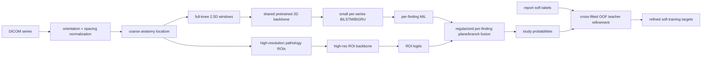

# Evidence-Backed Revision of the RSNA Knee Abnormality Detection Research Strategy

## Assessment, scope, and methodology

The uploaded artifact is not actually a completed research report; it is a detailed **research specification** describing the competition, current pipeline, measured failures, compute and licensing constraints, nine research questions, and a desired output format. It provides a strong experimental baseline—public leaderboard 0.927 versus 0.957 leader, 4,407 training studies, only 58 radiologist-verified studies, report-derived soft labels for the remaining 4,349 cases, and especially weak performance for synovitis, lateral OA, patellofemoral OA, fracture, and lateral meniscus tear—but it contains almost no external evidence or source verification. fileciteturn0file0

That distinction matters. I therefore treated the uploaded document as the **“original” baseline** and built the missing research report around it rather than pretending that unsupported prose already existed.

The most important weaknesses in the baseline are methodological rather than stylistic:

| Weakness in original brief | Why it matters | Revision made here |
|---|---|---|
| No literature-backed prioritization | Nine broad research questions leave dozens of possible experiments competing for ~30 GPU-hours/week | Experiments are ranked by expected macro-AUC gain × confidence ÷ compute |
| No distinction between direct and indirect evidence | An improvement on chest radiographs, CT, or a different Kaggle loss can easily be overgeneralized to knee MRI | Evidence below is explicitly classified as direct knee MRI, adjacent medical imaging, or competition evidence |
| No license audit | Many obvious knee datasets and medical pretrained models are non-commercial or research-only | Dataset and model licenses were checked against official repositories/model cards wherever possible |
| Tiny 58-study “gold” set is treated as ordinary validation | Per-finding architecture selection or ensemble optimization on 58 studies can massively overfit | Gold labels are reserved primarily as an audit set; model selection is moved toward cross-fitted noisy-label OOF predictions with shrinkage |
| Report-label noise is acknowledged but not operationalized | Training loss falling while validation AUC falls is exactly the pattern expected when a model eventually memorizes weak-label mistakes | The highest-priority intervention is cross-fitted image-guided label refinement rather than simply changing backbones |
| Current MIL treats localization mostly implicitly | Small cartilage, meniscus, fracture, and synovial findings have strong anatomical priors | A cheap anatomy-localization/high-resolution-ROI branch is prioritized |
| Prior failed transformers are not connected to external competition evidence | It would be easy to waste compute on another attention variant | The 2024 lumbar winner independently found self-attention/Mamba inferior to a simpler recurrent sequence model; this substantially strengthens the case against retrying large token transformers. citeturn1search0 |
| External data discussion lacks provenance controls | A nominal CC license does not make a derivative of a restricted dataset safe | Provenance, not merely the license badge, is treated as a gating requirement |

### Research method

I prioritized, in order, official Kaggle winner write-ups and code, peer-reviewed RSNA/Radiology/PubMed/Nature publications, official dataset repositories, and official pretrained-model cards or license files. Competition evidence was used when it contained real OOF/LB measurements, but not as a substitute for medical-imaging evidence. The search emphasized 2021–September 17, 2026, while retaining older foundational sources such as MRNet and MedicalNet where they remain directly relevant. citeturn18search6turn24search0

A crucial methodological rule throughout this report is: **a gain measured elsewhere is evidence of plausibility, not an expected gain on this competition**. The “expected macro-AUC gain” ranges below are engineering planning estimates based on how directly the evidence matches your setting. They are not literature results.

## Executive summary

The strongest conclusion from the research is that the remaining ~0.03 leaderboard gap is unlikely to close primarily through a larger generic backbone. Your own experiments already show that high-capacity sequence modeling and self-supervised feature learning can overfit protocol/scanner information, while the external evidence repeatedly favors **localization, small recurrent sequence heads, careful noisy-label handling, and model diversity**. fileciteturn0file0 citeturn0search0turn1search0turn25search2

### Ranked experiment portfolio

The gain ranges are my planning estimates for **incremental macro AUC over the current 0.927 system**, not published guarantees.

| Rank | Proposed intervention | Planning Δ macro AUC | Confidence | Incremental T4 cost | Gain/confidence/cost judgment |
|---|---|---:|---|---:|---|
| **Highest** | Cross-fitted image-model refinement of report labels | **+0.004 to +0.012** | Medium-high | ~12–20 GPU-h once; near-zero inference | Best match to the dominant failure mode |
| **Highest** | Anatomical localizer → native-resolution 448–512 ROI classifiers | **+0.004 to +0.010** | Medium-high | ~10–16 GPU-h for one ROI member | Particularly compelling for PF/lateral OA and lateral meniscus |
| **High** | Small BiLSTM/BiGRU inside each ordered series, then existing per-finding MIL | **+0.002 to +0.006** | Medium-high | ~5–10% overhead over one member | External competition evidence aligns strikingly with your transformer failures |
| **High** | Very-low-capacity disease-specific plane/sequence fusion | **+0.001 to +0.005** | Medium | <1 GPU-h head-only pilot | Cheap; likely useful for diagnoses with strong plane/sequence preferences |
| **Medium-high** | Noise-aware regularization: manifold/embedding mixup, mild affine/intensity augmentation, stricter early stopping | **+0.001 to +0.004** | Medium | ~same as one normal member | Addresses current memorization problem at low conceptual risk |
| **Medium** | Distill ensemble/OOF teacher probabilities into one student | **+0.001 to +0.005**, plus cheaper inference | Medium | ~6–10 GPU-h | Relevant evidence is unusually strong for lateral meniscus, although not identical supervision |
| **Medium-low** | MedicalNet 3D-ResNet10/18 diversity pilot | **−0.002 to +0.003** | Low | ~5–8 GPU-h | Permissive but no verified knee-transfer superiority over ImageNet |
| **Low-cost** | Shrunk ensemble weighting learned mainly from OOF, not 58 gold cases | **0 to +0.002** | Medium | CPU only | Small upside, almost no compute; avoids dangerous per-class tuning |

The top three ideas should be regarded as the main research program. Everything after them is secondary.

The recommended architecture is therefore not a radical redesign:

The architecture deliberately leaves your proven components intact: adjacent-slice 2.5D inputs, high-resolution ImageNet-pretrained CNNs, broad slice coverage, per-finding pooling, depth-reversal TTA, and architecture diversity. fileciteturn0file0

## Evidence-backed findings and implementation

### Cross-fitted image-guided refinement of report labels

**What it is.** Train image models out-of-fold, compare their probabilities with the LLM/report-derived labels, and use the image predictions to *softly* revise labels only when disagreement is large and the image teacher is demonstrably reliable. Do not simply replace all report labels with model predictions.

This is the most directly targeted response to your observation that training loss continues to fall while gold-set AUC falls. fileciteturn0file0

There are two unusually relevant pieces of empirical evidence. VisualCheXbert used a vision model to supervise a radiology-report labeler and improved average agreement with image-level reference labels by **0.14 F1** over a previous report-labeling approach; it also agreed with radiologists reading the actual images better than radiologists labeling the reports by roughly **0.12–0.21 F1**, depending on comparison. That is chest radiography rather than MRI, but the underlying problem—report-derived labels are imperfect proxies for image-visible pathology—is almost exactly yours. citeturn25academia44turn25search6

More directly from Kaggle, the second-place RSNA 2024 lumbar-spine team formed ensemble OOF predictions, removed examples for which the label-prediction discrepancy was ≥0.8, retrained, and reported approximately **1% improvement on both public and private leaderboards**. Importantly, another competitor reported failing to reproduce the improvement, which is an important warning that aggressive deletion can backfire. citeturn25search2turn25search1

**Recommended transfer.** Use the competition labels as a two-source supervision problem:

\[
\tilde y_{ic}
=
(1-\lambda_{ic})y^{report}_{ic}
+
\lambda_{ic}p^{OOF}_{ic}
\]

with \(\lambda_{ic}\) initially zero and allowed to rise only when the teacher is confident, teacher/report disagreement is high, and teacher quality for class \(c\) is acceptable on the gold sample. This preserves useful report supervision while reducing the influence of the worst mistakes.

Do **not** estimate a free confusion/transition matrix independently for each finding from 58 cases. Rare positive classes such as fracture will have too few verified positives for stable estimates, and repeated hyperparameter optimization against those same 58 studies is likely to create a misleading apparent gain.

A practical first experiment is three-fold cross-fitting with just **one** of the existing backbones, trained only 5–6 epochs with aggressive early stopping. Then:

- keep targets unchanged for small disagreements;
- move targets modestly toward the OOF prediction for high-confidence disagreements;
- never convert a soft label directly to 0/1;
- cap the maximum correction, for example at 0.25–0.35 probability units;
- test both correction and down-weighting—do not assume deletion is best.

The gold set should select at most a very small number of global quantities such as maximum correction strength, not dozens of finding-specific thresholds.

**Likely beneficiaries:** synovitis first, then lateral OA/PF OA/fracture, because these are precisely the classes where either interpretation is difficult or positive counts are likely to be sparse. Label-noise research also shows that “gold” labels themselves can be unstable for intrinsically difficult radiologic findings; agreement varies dramatically across findings. citeturn25search6

**Cost:** approximately 12–20 T4 GPU-hours for a compact three-fold teacher refresh under your current pipeline, with zero test-time overhead. This is an engineering estimate.

**Risk:** a weak teacher can reinforce its own mistakes. Cross-fitting is therefore mandatory; predictions from a model that was trained on the same sample should not be used as evidence that its original label is wrong.

### Anatomical localization followed by high-resolution ROI classification

**What it is.** Train a very cheap anatomy—not lesion—localizer and use it to extract disease-specific high-resolution crops. Continue using your full-knee branch in parallel rather than replacing it.

This is the most transferable pattern across recent RSNA winners. The 2022 cervical-spine winner used a two-stage approach: 3D segmentation/localization followed by a 2.5D classifier plus LSTM; remarkably, the localization stage was trained with only **87 studies containing 3D masks**. The winner explicitly reported that a direct 3D classifier did not work as well as the 2.5D/recurrent approach. citeturn0search0

The 2024 lumbar-spine winner similarly localized structures first and then classified high-resolution crops. Attention MIL improved the public leaderboard log loss from approximately **0.37 to 0.35**, while the eventual BiLSTM/auxiliary-loss/ensemble system reached roughly **0.33**. The second-place system's localizer put coordinates within 5 pixels of reference points about **99.1%** of the time before classification. citeturn1search0turn25search2

Knee-specific work provides stronger anatomical justification. A 1,435-study Radiology: Artificial Intelligence pipeline first localized knee structures, then classified cartilage, meniscus, bone-marrow and ACL lesions; tissue-specific AUCs were **0.83–0.93**. The associated system explicitly formed volumetric bounding boxes from anatomical segmentations before lesion grading. citeturn23search0

For cartilage specifically, an earlier automated segmentation-plus-local-classification system using fat-suppressed T2-weighted images obtained cartilage-lesion AUCs of **0.917 and 0.914** on repeated evaluations. citeturn23search5

The importance of effective spatial resolution is supported clinically as well: in a 2025 prospective arthroscopy-validated study, superresolution knee MRI increased articular-cartilage diagnostic AUC from **0.71 to 0.78** while meniscus and ACL performance stayed similar. That does not prove that a superresolution network will improve your model, but it does support the narrower claim that preserving fine spatial information can particularly help cartilage pathology. citeturn23search2

**Recommended transfer.** Do not build a giant lesion detector. Manually annotate coarse anatomical boxes/keypoints on perhaps 80–150 competition studies:

- patella/trochlea;
- medial and lateral tibiofemoral compartments;
- medial/lateral meniscus anterior/posterior horn envelopes;
- intercondylar notch;
- broad marrow regions.

A lightweight U-Net/heatmap network at 256 px is enough if the sole job is crop placement.

Then add only a few pathology-specific ROI members:

| Weak finding | Most defensible targeted branch |
|---|---|
| PF OA | axial patellofemoral + sagittal patella/trochlea, 448–512 native-resolution crop |
| Lateral OA | lateral tibiofemoral compartment in coronal + sagittal |
| Lateral meniscus | sagittal + coronal lateral horn crops |
| Synovitis | fluid-sensitive Hoffa/suprapatellar/posterior recess crops, but expect a lower ceiling |
| Fracture | broad bone ROI rather than tiny detector; there is insufficient high-quality published knee-fracture DL evidence to recommend a narrower architecture |

The lateral meniscus deserves particular attention. A large meniscus-localization/classification study obtained AUC **0.93 medial versus 0.84 lateral**, and arthroscopy-validated work similarly shows systematically weaker lateral performance. A recent meta-analysis of MRI diagnosis found pooled sensitivity around **91.0% for medial meniscus tears versus 78.5% for lateral tears**, implying that your .87 lateral AUC versus .96 medial AUC is not merely an implementation accident. citeturn11search0turn12search9

**Planning gain:** +0.004–0.010 macro AUC, concentrated in PF OA, lateral OA and lateral meniscus. **Cost:** roughly 2–4 GPU-hours for a lightweight locator and 8–12 hours for one targeted classifier; inference increase can be held to roughly 10–25% by running ROIs only for selected findings.

**License:** requires no external weights or data if you create coarse anatomy annotations from the competition training set.

**Major risk:** crop errors can erase pathology. Retain the full-knee prediction and fuse it with the ROI branch rather than forcing the ROI model to become the sole classifier.

### A small recurrent sequence model instead of another transformer

**What it is.** Preserve ordered slice/window information inside each series with a small one-layer bidirectional GRU or LSTM, then feed those contextualized embeddings into your existing per-finding attention MIL.

The case for this is unusually strong because external evidence reproduces your own negative result. The 2024 lumbar-spine winner found that attention MIL helped, then obtained further gains with a **BiLSTM plus auxiliary losses and ensembling**, whereas self-attention and Mamba replacements did not work. citeturn1search0 The 2022 cervical-spine winner also used a 2.5D encoder followed by LSTM sequence aggregation after finding the direct 3D classifier unsatisfactory. citeturn0search0 Earlier RSNA intracranial-hemorrhage winning work likewise emphasized sequential modeling over independent-slice classification. citeturn1search4

This does **not** mean replacing attention pooling. A good implementation is:

\[
e_1,\ldots,e_n
\rightarrow \operatorname{BiGRU}(e_1,\ldots,e_n)
\rightarrow h_1,\ldots,h_n
\rightarrow \text{current per-finding attention}
\]

Use one recurrent block with hidden width around 128–256, dropout, and perhaps a residual projection from \(e_i\) to \(h_i\). The recurrence should be reset at series boundaries. Missing slots should not be padded into an artificial anatomical sequence.

Start by caching backbone embeddings and training only the sequence head. This tests the hypothesis for almost no compute. Only if the cached-feature experiment improves paired validation should you fine-tune end-to-end.

**Likely beneficiaries:** meniscus and fracture/contusion, where pathology continuity across neighboring slices matters; possibly synovitis. It is less likely to move Baker’s cyst or obvious ACL tears, which are already near ceiling.

**Planning gain:** +0.002–0.006 macro AUC. **Inference cost:** likely a few percent because the CNN remains the dominant cost.

**Main risk:** recurrence can still memorize study protocols. Keep the recurrent head small and regularized.

### Disease-specific plane and sequence fusion with almost no capacity

CoPAS is particularly relevant because it addressed **twelve knee MRI abnormalities** from multiple MRI sequences and planes. In 1,748 patients across five centers, the model reported average internal AUC around **0.812** and outperformed MRNet, MPFuseNet, and ELNet for 8 of 12 abnormalities. More revealingly, removing T1/T2 information dropped bone-contusion AUC from approximately **0.821 to 0.698**, illustrating that “MRI series” are not interchangeable channels. citeturn16search0turn16search1

The paper also describes clinically meaningful plane preferences: meniscal pathology relies heavily on sagittal and coronal views, cruciate ligaments on sagittal imaging, and collateral ligaments particularly on coronal views. citeturn16search0 MRNet similarly combined plane-specific networks rather than learning one unconstrained global image stream; its original AUCs were 0.937 for abnormality, 0.965 for ACL tear and 0.847 for meniscal tear. citeturn18search6

However, I did **not** find a clean published ablation establishing that a CoPAS-style transformer beats your exact current per-finding attention MIL. Given your two failed cross-slice transformer experiments, copying CoPAS wholesale would be a poor risk/reward decision.

Instead, use a tiny fusion layer. Produce logits or compact features separately for Sag-FS, Sag-nonFS, Cor-FS, Cor-nonFS and Axial, then learn disease-specific convex weights:

\[
z_c=\sum_s \operatorname{softmax}(w_{c,s})z_{c,s}.
\]

Initialize those weights uniformly and impose entropy/L2 regularization so that 4,000 weakly labeled studies cannot learn arbitrary routing. An even safer experiment fixes plausible routing priors and learns only one residual scalar.

This differs from your already-failed “group slices into per-series slot embeddings then pool” experiment: the proposed layer operates only on **already-computed logits or very low-dimensional features** and is explicitly regularized rather than adding another expressive pooling stage. fileciteturn0file0

**Planning gain:** +0.001–0.005. **Cost:** effectively negligible after features are available.

### Regularization and augmentation should target noise, not visual novelty

Your current augmentation is intensity gain only. fileciteturn0file0 That leaves room for improvement, but the literature does not justify an indiscriminate “Albumentations everything” strategy.

The second-place 2024 lumbar solution used heavy augmentation, sequence reversal and **manifold mixup on embeddings**, while first-stage crop/index perturbations were repeatedly reported by top teams as useful for making downstream classifiers robust to localization errors. However, isolated AUC contributions for most individual augmentation operations were not published. citeturn25search0turn25search1

Knee-MRI work on cross-domain cartilage segmentation found that mixup improved robustness to scanner/acquisition changes and was more computationally economical than adversarial domain adaptation, though the accessible abstract does not provide an isolated classification-AUC delta. citeturn23academia36

I would therefore test a deliberately small augmentation bundle:

- mild in-plane rotation, scale and translation;
- modest gamma/contrast and noise;
- mild blur/downsampling to mimic scanner-resolution variability;
- embedding-level mixup after the backbone rather than CutMix over anatomical pixels.

A **naive left-right image flip is unsafe** because the task contains distinct medial and lateral labels. fileciteturn0file0 A flip is acceptable only after DICOM orientation has been standardized and medial↔lateral labels and ROI identities are explicitly remapped.

Bias-field and k-space corruption are reasonable research ideas, but I found **no convincing knee multi-label AUC ablation** showing that they improve a setting close to yours. They should not displace higher-priority experiments.

### Distill the teacher ensemble, especially for lateral meniscus

Knowledge distillation has unusually interesting knee-specific evidence. In one meniscus study, an undistilled student obtained AUCs of **0.773 medial / 0.672 lateral**; distillation raised them to **0.792 / 0.751**, corresponding to +0.019 medial and a much larger **+0.079 lateral**. The teacher supervision in that paper differs from your setup, so the +0.079 should not be interpreted as an expected competition gain, but it demonstrates that a weak lateral-meniscus student can benefit disproportionately from richer teacher probabilities. citeturn11search14

For your team, the natural teacher is your own architecture ensemble. That satisfies the rule forbidding other competitors’ weights.

Use cross-fitted teacher predictions on training studies and optimize something like:

\[
L = (1-\alpha)\,BCE(p,y_{\text{refined}})
 + \alpha\,KL(p,p_{\text{teacher}})
\]

with \(\alpha\) modest rather than near 1.

A particularly attractive variant is to distill into a **single high-resolution ROI student**, allowing it to combine the teacher’s study-level knowledge with better local spatial detail.

**Planning benefit:** potentially +0.001–0.005 macro AUC, with larger class-specific upside for lateral meniscus, and an inference reduction if the student replaces multiple ensemble members. **Cost:** roughly one additional training run.

### Ensemble optimization should be shrunk aggressively toward equal rank averaging

Your current rank-average is a strong baseline because the competition metric itself is ranking-based. fileciteturn0file0 With only 58 gold studies, unrestricted per-finding ensemble optimization has a poor bias/variance trade-off.

I would use:

\[
w^*=(1-\lambda)w_{\mathrm{equal}}+\lambda w_{\mathrm{OOF}},
\]

where \(w_{\mathrm{OOF}}\) comes from predictions on the 4,349 weakly labeled studies and \(\lambda\) is the only quantity selected using the gold set.

Practical options are deliberately low-dimensional: equal rank-average; one global ConvNeXt-versus-CoAtNet weight; or at most one family weight for the ROI branch versus global branch. Do not fit five series weights × multiple backbones × twelve findings using the 58 verified studies.

For every claimed improvement on the gold set, report a paired bootstrap distribution of macro AUC difference rather than only the point estimate. A change that wins by 0.005 on 58 cases but changes sign in half the bootstrap resamples is not credible enough to justify replacing a leaderboard-proven equal ensemble.

## Competition, noisy-label, and knee-specific evidence

### What transfers from prior RSNA winners

The strongest cross-competition pattern is **coarse-to-fine processing**, not exotic global attention.

| Competition / source | Measured or reported result | Transferability to this task |
|---|---|---|
| RSNA 2022 Cervical Spine, 1st | 87 masked studies sufficient for localization; final pipeline used localization → 2.5D → LSTM; direct 3D classifier reported ineffective | **High** for anatomy crops and recurrent slice modeling. citeturn0search0 |
| RSNA 2023 Abdominal Trauma, 1st | Multi-stage organ localization + 2D CNN/RNN; best single OOF weighted log loss ~0.326, ensemble ~0.31x | **Moderate-high** for localization and architecture-level ensembling. citeturn0search5 |
| RSNA 2024 Lumbar, 1st | Attention MIL roughly 0.37→0.35 public log loss; BiLSTM/auxiliary losses/ensemble ~0.33; self-attention/Mamba unsuccessful | **Very high**, because it mirrors your own sequence-transformer failure. citeturn1search0 |
| RSNA 2024 Lumbar, 2nd | OOF disagreement-based label cleaning reportedly improved both public and private LB ~1%; localization within 5 px ~99.1% | **Very high** for label refinement and crop robustness. citeturn25search2 |
| RSNA 2019 Intracranial Hemorrhage, 1st | Winning system emphasized sequential modeling of neighboring CT slices | **Moderate**; reinforces sequence context but modality differs. citeturn1search4 |
| RSNA 2020 PE | Sequence models inherited from earlier RSNA solutions; retrieved primary write-up did not expose a trustworthy isolated gain | **Moderate**; no numeric claim should be made |
| RSNA 2024 overall solution review | Most strong solutions localized relevant level/region before classification; left/right and level decomposition increased effective supervised examples | **High** conceptual support for structured crops. citeturn1search8 |

Pseudo-labeling is therefore best used here for **denoising or soft-target refinement**, not simply for adding more predictions to already weak labels.

### Noisy report labels

The medical literature strongly supports treating report-derived labels as a distinct supervision source rather than as unquestioned ground truth. VisualCheXbert demonstrates that image-supervised report-label refinement can materially improve agreement with image-visible findings. citeturn25academia44 CheXpert likewise explicitly represented uncertainty when creating labels from radiology reports rather than forcing every mention into an ordinary binary ground truth. citeturn3search5

Co-teaching and consistency-based correction methods have also outperformed conventional noisy-label methods on medical image classification datasets including ISIC and thyroid ultrasound, although the accessible primary abstract did not provide an isolated AUC delta suitable for quantitative transfer here. citeturn25search3 I therefore would **not** spend two full T4 training streams on classical co-teaching before testing the much cheaper OOF-refinement strategy.

The 58 verified studies are more valuable as an independent anchor than as a transition-matrix estimation dataset. Especially for rare findings, the number of positive gold cases may be too small for reliable finding-specific noise-rate estimation. This is an inference from your sample size and should be tested by reporting exact positive counts and bootstrap intervals rather than assumed.

### What the literature says about the weak findings

**Lateral meniscus tear.** This is a genuinely difficult imaging target. A large localization/classification study achieved medial/lateral AUCs of roughly **0.93/0.84**, while arthroscopy-validated clinical MRI also shows lower lateral than medial sensitivity. citeturn11search0turn23search2 The meta-analytic pooled MRI sensitivity difference—about **91.0% medial versus 78.5% lateral**—is consistent with your observed .96/.87 imbalance. citeturn12search9 The best response is therefore local high-resolution two-plane modeling, not merely reweighting the loss.

**Patellofemoral and lateral OA/cartilage.** High-resolution anatomy-aware approaches repeatedly outperform whole-volume generic classification in cartilage work. The 1,435-study ROI pipeline obtained cartilage lesion AUC around **0.93**, while an independent segmentation/classification pipeline obtained roughly **0.917**. citeturn23search0turn23search5 The 2025 arthroscopy study's improvement from 0.71 to 0.78 when fine spatial information was enhanced further supports prioritizing native-resolution ROI crops. citeturn23search2

**Synovitis.** This class may have the lowest attainable ceiling in your non-contrast data. Routine non-contrast fluid-sensitive MRI can confound joint fluid and synovial thickening, whereas contrast-enhanced fat-suppressed T1 imaging separates enhancing synovium more directly. citeturn13search0 This makes synovitis a strong candidate for *lower report-label trust* and uncertainty-aware training. A large architecture is unlikely to recover information that the acquisition itself does not clearly encode.

**Bone contusion.** CoPAS provides unusually direct sequence evidence: removing T1/T2 sequences reduced bone-contusion AUC from **0.821 to 0.698**. citeturn16search0 Therefore, do not let a single fluid-sensitive branch dominate every bone finding; retain weighting information.

**Fracture.** I did not find a high-quality knee-MRI deep-learning study with a clean ablation sufficiently close to your study-level fracture task to justify a specific architecture or promise a numerical gain. The correct conclusion is **no strong direct evidence found**. A broad bone ROI plus both fluid-sensitive and non-fluid-sensitive series is a reasonable experiment, but it should be labeled a hypothesis rather than literature-established best practice.

### Multi-plane fusion

The literature supports multiple planes, but not necessarily heavy cross-plane transformers. A recent knee multi-task study found sagittal/coronal fusion superior to either plane alone for meniscal analysis and reported classification F1 around 0.976 medial and 0.905 lateral, while segmentation multitask learning improved lateral-meniscus Dice by approximately 2.3% coronal and 4.4% sagittal relative to the reported baseline. citeturn14search3

At the same time, a 2026 study reported a sagittal-only ACL AUC of 0.976 versus about 0.949 for one three-plane hybrid, demonstrating that adding views can hurt when fusion adds noise or capacity. citeturn14search2 That is exactly why your next fusion experiment should be a tiny regularized logit gate, not another token transformer.

## Pretrained models and external data

### Pretrained models

The most important answer to Q4 is negative: **I found no permissively licensed pretrained medical model with convincing published evidence that it beats your ImageNet initialization specifically on knee/MSK MRI classification.** There are legal candidates worth a cheap diversity test, but none merits replacing the current ImageNet-12k ConvNeXt/CoAtNet system without an ablation.

| Model | Pretraining | License verified | Format / scale | T4 practicality | Direct knee/MSK evidence | Recommendation |
|---|---|---|---|---|---|---|
| **MedicalNet / Med3D** | Heterogeneous 3D medical datasets; official repo provides 3D ResNet-10/18/34/50 checkpoints trained over 23 datasets | **Yes — MIT** in official repository. citeturn24search0 | 3D volumes; official page does not provide reliable parameter counts for every checkpoint | R10/R18 practical; R50 less attractive | **No direct knee-classification superiority found** | **Conditional pilot only** |
| **RAD-DINO** | Self-supervised chest radiographs, ViT-B/14, ~86.6M vision parameters | **Yes currently — MIT**; the license was changed from the earlier Microsoft research license in 2025. citeturn10search0turn10search1turn10search6 | 2D radiographs | Fits T4 for fine-tuning with care | **No verified knee/MRI transfer evidence** | Low priority because your generic frozen DINO features already failed |
| **BiomedCLIP** | 15 million biomedical figure-caption pairs from PMC; ViT-B/16 vision encoder at 224 | **Yes — MIT** on current official model card. citeturn24search1turn24search3 | 2D, 224×224 canonical input | Practical | No knee MRI superiority found; pretraining covers many biomedical image types rather than MRI specifically | Cheap one-member pilot at most |
| **Current ImageNet-12k ConvNeXt/CoAtNet** | Natural-image supervised pretraining | Reported by team as acceptable/permissive | 2D/2.5D | Already proven | Your strongest empirical evidence | **Remain the default** |

MedicalNet's evidence of transfer is real but comes primarily from volumetric segmentation. In the official repository's lung-segmentation transfer example, 3D ResNet-10 improved Dice from **69.31% scratch to 96.56% pretrained**, ResNet-18 from **70.89% to 94.68%**, ResNet-34 from **75.25% to 94.14%**, and ResNet-50 from **52.94% to 89.25%**. citeturn24search0 That proves that the weights can provide useful medical-volume initialization, not that they will beat ImageNet on a 4,407-study knee classifier.

BiomedCLIP is similarly legitimate—PMC-15M contains 15 million biomedical image-text pairs and the official checkpoint is MIT—but its canonical 224-pixel ViT representation is poorly aligned with your observation that higher resolution helps. citeturn24academia44turn24search3

### External knee data

This audit produces one useful surprise: there is now at least one substantial permissive knee-MRI dataset, **KMAR-50K**, but it does not contain the pathology labels you need.

| Dataset | Size / labels | Exact relevant terms | License verified? | Usable under stated rule? | Decision |
|---|---|---|---|---|---|
| **KMAR-50K** | 1,190 patients, 1,444 paired multi-view/multi-sequence scans, 62,506 images; motion-artifact/clean pairs and quality scores, not pathology labels | Mendeley repositories explicitly list **CC BY 4.0**. citeturn21view0turn21view1 | **Yes** | **Yes, legally; limited task usefulness** | Could support domain pretraining or artifact robustness, but low priority after your own SSL failure |
| **MRNet** | 1,370 studies; abnormality, ACL, meniscus labels | Stanford AIMI data access is governed by non-commercial research terms rather than a permissive CC/MIT-style data license. citeturn17search8turn7search3 | Yes enough to reject | **No** | Do not use images |
| **fastMRI knee** | Large knee MRI/k-space reconstruction dataset | Official terms restrict use to research/education and prohibit commercial exploitation rather than granting a permissive data license. citeturn6search1 | Yes | **No** | Reject |
| **SKM-TEA** | 155 qDESS scans, segmentations/pathology boxes | Code is MIT, but dataset access routes through Stanford AIMI non-commercial terms. citeturn7search8turn7search3 | Yes | **No data** | Architecture/code ideas only |
| **OAI** | 4,796 participants, longitudinal OA imaging | Public research resource, but I did not verify a competition-safe permissive license for source MRI; available terms involve registration/agreements rather than plain CC BY | **No** | **No under your hard rule** | Reject until organizers/legal reviewer confirms |
| **CoPAS dataset** | 1,748 patients; 12 knee abnormalities | Authors state academic/non-commercial sharing via agreement/MTA. citeturn16search0 | Yes | **No** | Paper architecture only |
| **ACL-PCL Mendeley** | 970 post-augmentation images; normal/torn ACL/PCL, several views | Repository says **CC BY 4.0**. citeturn22search0 | License yes; provenance quality less strong | **Conditional** | Too small/unclear provenance to prioritize; audit patient/source lineage first |
| **Roboflow “KneeMRI” derivatives** | ~4.5k images; normal/ACL/meniscus classes | Site labels them CC BY 4.0, but source provenance is insufficiently documented. citeturn22search10turn22search11 | Badge yes; lineage no | **No for now** | High risk of restricted-source derivative or leakage; reject without provenance |

A subtle legal point is worth preserving in your records: the **KMAR-50K dataset repositories themselves explicitly specify CC BY 4.0**, while the accompanying Scientific Data *article* is published under CC BY-NC-ND 4.0. citeturn21view0turn20view0 Those are licenses on different objects—the dataset versus article—but because your rule is exceptionally strict, archive a screenshot or copy of the Mendeley dataset-license page with your experiment artifacts.

KMAR-50K includes coronal, sagittal and transverse PD/T1/T2 acquisitions at 1.5T and 3T, which makes it genuinely relevant MRI-domain data. citeturn18search0 Nonetheless, pathology-free external pretraining is not a priority after your in-domain DINO experiment performed worse than scratch. The only compelling use would be a *small* robustness experiment such as clean-versus-motion consistency, not a weeks-long SSL project.

## Do not pursue

**Another full cross-slice transformer, Mamba, or large co-plane attention model.** Your team has already lost twice with slice self-attention. fileciteturn0file0 The 2024 lumbar winner independently found self-attention and Mamba inferior to its simpler recurrent formulation. citeturn1search0 This is unusually strong convergent negative evidence.

**DINO-style SSL on your own competition images.** It has already failed and frozen DINOv2 features clustered scanner protocol rather than pathology. fileciteturn0file0 RAD-DINO and BiomedCLIP remain legal diversity pilots, but neither has direct knee-MRI transfer evidence strong enough to justify another major pretraining effort. citeturn24search3turn10search0

**Full-volume 3D classification as a mainline replacement.** The 2022 cervical winner reported that direct 3D classification was not successful relative to 2.5D/LSTM, while your compute budget and anisotropic multi-series input make a heavy 3D model particularly expensive. citeturn0search0 MedicalNet R10/18 is worth at most a cheap diversity experiment.

**More low-resolution slices.** This is contradicted directly by your experiments. fileciteturn0file0 The clinical cartilage evidence points in the opposite direction: small cartilage abnormalities benefit from effective spatial resolution. citeturn23search2

**Attention-selected top slices as a separate filtering stage.** This already overfit internally. fileciteturn0file0 Modern winning competition pipelines localize anatomy with explicit supervision or structurally constrained keypoints rather than asking the classification attention scores themselves to discover all anatomy.

**Unrestricted per-finding ensemble weight search on the 58 gold studies.** Even if it produces a large apparent local gain, it creates 12 independent opportunities to fit validation noise. Use OOF-derived weights and shrinkage instead.

**A transition matrix per finding estimated directly from 58 gold cases.** For low-prevalence labels, the relevant cells will contain too few cases to estimate stable corruption rates. A simple global correction-strength model is safer.

**Hard deletion of every model/report disagreement.** RSNA 2024 second place reported a +1% LB gain from OOF noise removal, but another competitor explicitly reported that a similar attempt hurt. citeturn25search2turn25search1 Start with soft corrections or sample-weight reduction.

**Training a superresolution network as a preprocessing dependency.** The clinical evidence establishes that better effective resolution can improve cartilage detection, not that learned SR on your distribution improves downstream model AUC. citeturn23search2 Native-resolution ROI crops are much cheaper and safer.

**MRNet, fastMRI, SKM-TEA, OAI or CoPAS images without a separately verified permissive license.** MRNet/SKM-TEA inherit non-commercial access conditions from Stanford AIMI, fastMRI has restrictive research terms, OAI is not verified against your permissive-only standard, and CoPAS data are academic/non-commercial. citeturn7search3turn6search1turn16search0

**Roboflow knee-MRI collections merely because a page says CC BY.** A permissive badge does not cure uncertain upstream provenance. citeturn22search10

**Naive horizontal flipping.** Medial and lateral OA/meniscus are separate outputs. fileciteturn0file0 Only use a flip if orientation is normalized and all affected target identities are permuted correctly.

**Treating synovitis like an ordinary high-SNR structural finding.** Non-contrast fluid-sensitive MRI has inherent difficulty separating effusion from synovial thickening compared with contrast-enhanced imaging. citeturn13search0 The first intervention for that class should be label-confidence modeling and appropriate ROI/sequence routing, not a larger network.

## Comparison, next steps, and reproducible search log

### Original versus revised research product

| Original brief | Revised report | Added evidence / source type | Why the revision matters |
|---|---|---|---|
| “Investigate prior RSNA winners” | Identified coarse-to-fine localization, recurrent sequence models, noise removal, auxiliary heads and ensembling; separated measured gains from qualitative claims | Kaggle winner write-ups for RSNA 2022–2024. citeturn0search0turn1search0turn25search2 | Converts a broad question into concrete experiments |
| “Labels are noisy; investigate methods” | Cross-fitted image-guided soft refinement is the top recommendation; hard deletion downgraded to an ablation | VisualCheXbert +0.14 F1; RSNA lumbar OOF noise cleaning ~1% LB. citeturn25academia44turn25search2 | Directly targets the current overfitting failure mode |
| “Weakest: synovitis, lateral/PF OA, fracture, lateral meniscus” | Different diagnosis-specific remedies rather than one generic architecture | Knee ROI pipelines, meniscus meta-analysis, synovitis imaging literature. citeturn23search0turn12search9turn13search0 | Small findings have different information bottlenecks |
| “Investigate multi-plane fusion” | Recommend tiny per-finding logit/feature gates, explicitly reject another large transformer | CoPAS, MRNet, 2024 lumbar recurrent results. citeturn16search0turn18search6turn1search0 | Respects your two prior transformer failures |
| “Find medical pretraining” | No permissive model with verified knee superiority found; MedicalNet/BiomedCLIP/RAD-DINO downgraded to pilots | Official MIT model repositories/cards. citeturn24search0turn24search3turn10search1 | Prevents expensive model chasing |
| “Find external knee data” | Most famous datasets rejected; KMAR-50K identified as legitimately CC BY but pathology-free | Official Mendeley, Stanford, fastMRI and paper terms. citeturn21view0turn7search3turn6search1 | Turns licensing into a hard experimental gate |
| “Investigate augmentation” | Recommends mild geometry/intensity plus embedding mixup; warns against naive flips | RSNA 2024 and knee-MRI robustness work. citeturn25search0turn23academia36 | Avoids augmentations that alter task semantics |
| “Investigate efficiency” | Proposes cached-feature head screening, ROI-only high resolution and ensemble distillation | Knee distillation and competition evidence. citeturn11search14 | Fits the 30 GPU-hour/week budget |
| “Investigate ensemble weights” | OOF-derived weights shrunk toward equal rank average; gold set used only for a low-dimensional shrinkage decision | Statistical recommendation based on the stated n=58 constraint | Reduces validation overfit |
| No literature search log | Reproducible search strategy below | Primary sources prioritized | Makes future updates auditable |

### Prioritized experimental sequence

The first week should be dominated by **label noise**, because a better architecture trained against systematically wrong targets will eventually learn those wrong targets more efficiently. Generate three-fold OOF predictions from one established backbone, quantify report/model disagreement by finding, and test soft refinement versus down-weighting. Do not yet add a new backbone.

The second experiment should be a **cached-feature BiGRU/BiLSTM head**. Because backbone embeddings can be frozen, this can determine whether ordered sequence context adds information in well under the cost of a normal full training run. Promote it to end-to-end training only if paired gold/OOF evidence is positive.

The third should be a **small manually annotated anatomy localizer** and one ROI problem, preferably PF OA or lateral meniscus. Do not annotate lesions. If a 100-study anatomy localizer produces stable crops, train one 448–512 ROI classifier and fuse it with the existing global score.

Next, add the **very-low-capacity series gate**. This should be essentially free and can be evaluated separately for the five weakest findings.

Only after those experiments should you spend a run on **embedding manifold mixup plus mild affine/intensity augmentation**, because augmentation is less likely than label refinement/localization to produce a step-change.

Then distill the strongest ensemble into one student, with special attention to lateral meniscus. Knee-specific evidence suggests lateral meniscus may benefit substantially from teacher supervision. citeturn11search14

MedicalNet, RAD-DINO and BiomedCLIP belong at the end of the queue. None has sufficient direct knee-MRI transfer evidence to displace the experiments above. citeturn24search0turn24search3turn10search0

### Suggested experiment acceptance criteria

Because the gold set is so small, a single macro-AUC point estimate should not decide experiments. For every model change, retain predictions for all 58 cases and calculate paired bootstrap differences against the same baseline.

A reasonable decision rule is:

1. improvement in full 12-class macro AUC;
2. improvement in at least two of the five currently weak findings without a material loss in the strong findings;
3. positive median paired bootstrap delta;
4. no obvious dependence on a handful of gold cases;
5. corroboration on noisy-label OOF metrics, while recognizing those metrics are imperfect.

For label-refinement experiments specifically, also measure whether train-loss/validation-AUC divergence occurs later. Even if the peak AUC gain is initially modest, delaying the onset of weak-label memorization is evidence that the intervention is targeting the stated failure mode.

### Reproducible search log

| Source/database | Representative query families | Date scope | Selection rule |
|---|---|---|---|
| Kaggle competition write-ups | `RSNA 2019 intracranial hemorrhage 1st solution sequence`; `RSNA 2020 pulmonary embolism 1st solution`; `RSNA 2022 cervical fracture 1st`; `RSNA 2023 abdominal trauma 1st`; `RSNA 2024 lumbar spine 1st 2nd noisy labels LSTM` | 2019–2026 | Top-solution write-ups/code with measured CV/LB evidence |
| PubMed / RSNA journals | `knee MRI deep learning meniscus lateral AUC`; `cartilage lesion segmentation classification knee MRI`; `synovitis noncontrast contrast MRI`; `knowledge distillation meniscus MRI` | Primarily 2021–2026 | Peer-reviewed first; exact diagnostic/AUC values prioritized |
| Nature / Scientific Data | `multi sequence knee MRI twelve abnormalities co-plane`; `open knee MRI dataset license` | 2021–2026 | Primary articles and official dataset descriptors |
| Official dataset portals | MRNet/Stanford AIMI, fastMRI/NYU, OAI, Mendeley KMAR-50K | Current terms checked September 2026 | License/access terms override secondary descriptions |
| Hugging Face / official model repositories | `RAD-DINO license`; `BiomedCLIP license`; MRI/medical foundation models | Current model cards, September 2026 | Exact current license required |
| GitHub official repositories | MedicalNet/Med3D and winning-solution repositories | Current | Official author repositories only for licensing/implementation claims |
| Noisy-label literature | `radiology report labels image labels`; `VisualCheXbert`; `co-teaching medical image noisy labels`; `LLM radiology report label noise` | 2021–2026 | Image-label/report-label mismatch and measurable downstream evidence |
| Augmentation literature | `knee MRI mixup`; `MRI augmentation classification`; `bias field k-space augmentation` | 2019–2026 | Direct knee MRI preferred; no gain claimed when isolated ablation unavailable |

The search uncovered a notable evidence gap: despite many knee-MRI papers, there is **little high-quality, directly transferable evidence for study-level synovitis or knee-fracture deep learning under routine heterogeneous multi-series MRI**, and similarly little evidence that any permissively licensed medical foundation model currently outperforms strong ImageNet initialization specifically for knee MRI. Those gaps should remain labeled as gaps rather than filled with speculative claims.

The resulting research priority is therefore clear: **clean the supervision first, localize small anatomy second, add a small recurrent sequence model third, and spend the remaining compute on low-capacity fusion and diverse ensembles—not another large transformer or unverified external dataset.**