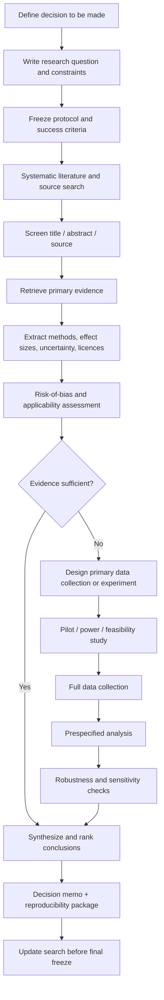
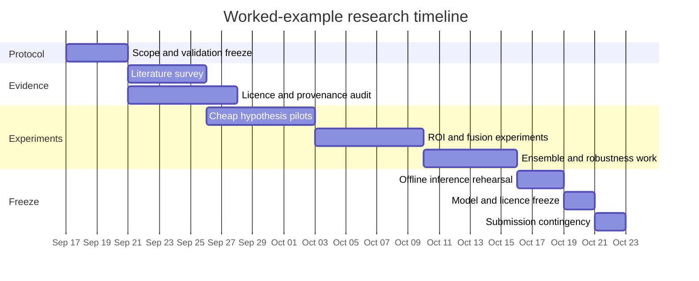

# Deep Research Blueprint and Initial Literature Survey Framework

## Executive summary

This report assumes that **no single substantive research topic has yet been selected**, so the immediate objective is to build a reusable, auditable deep-research process rather than prematurely optimize for one question. As a worked example, I use the uploaded brief on **improving a multi-label knee-MRI classifier for the 2026 RSNA Knee Abnormality Detection Kaggle competition**. That brief specifies a 12-finding MRI classification problem, noisy report-derived labels, only 58 radiologist-verified studies, a macro-ROC-AUC objective, tight T4 compute limits, and strict permissive-licensing requirements. fileciteturn0file0

The highest-value research activities should be prioritized by a simple decision rule:

\[
\text{Priority} =
\frac{\text{decision impact}\times\text{evidence strength}\times\text{feasibility}}
{\text{cost}\times\text{risk}}
\]

with each term scored from 1–5. This prevents interesting but low-actionability literature from consuming the project.

The recommended order of work is:

| Priority | Workstream | Why it comes early |
|---|---|---|
| **Very high** | Freeze the research question, success metric, constraints, and exclusion criteria | Prevents scope drift and post-hoc hypothesis changes |
| **Very high** | Build an evidence ledger and search protocol | Makes the review reproducible and exposes unsupported claims |
| **Very high** | Audit data/model licences independently of technical merit | An unusable model or dataset has zero practical value |
| **High** | Search primary literature and first-party competition solutions | Maximizes actionable evidence per hour |
| **High** | Design validation and statistical analysis *before* experiments | Small validation sets make apparent gains particularly unstable |
| **High** | Run low-cost falsification pilots before expensive studies | Eliminates weak hypotheses early |
| **Medium-high** | Collect new primary data only where literature/secondary data cannot answer the question | Primary collection is generally the most expensive stage |
| **Medium** | Synthesize, replicate, and stress-test the strongest findings | Distinguishes transferable effects from benchmark-specific tricks |

For a systematic or semi-systematic literature component, PRISMA 2020 is the appropriate general reporting backbone: it calls for an explicit research objective, prespecified inclusion/exclusion criteria, documented information sources and search dates, risk-of-bias methods, and explicit synthesis procedures. citeturn4search0turn4search4 For medical-imaging AI specifically, CLAIM 2024 adds domain-relevant expectations around datasets, model development, evaluation, reproducibility, and reporting. citeturn4search1turn4search2

Two assumptions materially affect the plan:

**Assumption A.** The uploaded knee-MRI brief is treated as the *worked example*, while the research framework itself is topic-agnostic.

**Assumption B.** “Evidence” means a result traceable to a primary paper, official dataset/model documentation, regulatory/standards document, or first-party competition solution. Reviews are valuable for discovery but should not normally be the final evidentiary anchor.

**Assumption C.** For fast-moving fields, especially AI, the search should run through **September 17, 2026**, with a final update immediately before conclusions are frozen. PRISMA explicitly recommends documenting which sources were searched and the date of the last search. citeturn4search0turn4search10

## Research question, scope, and decision framework

### A reusable research-question template

A robust question should contain enough structure that two researchers would independently retrieve substantially the same evidence.

> **In [population/problem/context], does [intervention, exposure, method, or design choice], compared with [baseline/comparator], improve [primary outcome], while satisfying [cost, safety, legal, compute, or operational constraints], over [time horizon], and what evidence would be sufficient to change the current decision?**

For methodological or machine-learning research, expand this into:

> **For [dataset/domain/task], does [method A] versus [current baseline B] produce a reproducible improvement in [primary metric], measured on [evaluation unit and validation design], without unacceptable deterioration in [secondary metrics], while respecting [compute/data/licence/deployment constraints]?**

The final clause—*what evidence would change the decision*—is crucial. It converts literature review from information accumulation into decision support.

### Topic-selection criteria

Score candidate topics before performing a full review. A useful weighted matrix is:

| Criterion | Suggested weight | High score means |
|---|---:|---|
| Decision impact | 20% | Result would materially change policy, product, experiment, or resource allocation |
| Measurability | 15% | Primary outcome can be defined objectively |
| Evidence availability | 15% | Sufficient primary literature/data probably exist |
| Practical feasibility | 15% | Can be answered with available time, people, compute, and access |
| Novelty / unresolved uncertainty | 10% | Existing evidence is genuinely incomplete or conflicting |
| Data accessibility | 10% | Required data can legally and technically be obtained |
| Ethical/legal acceptability | 10% | Risks and permissions are manageable |
| Replicability | 5% | Another researcher could independently verify the result |

A topic scoring below roughly **3/5 on either feasibility or decision impact** should usually be narrowed or deferred, regardless of its intellectual interest. That threshold is a project-management heuristic, not an empirical scientific law.

### Scope freeze

Before searching deeply, produce a one-page protocol containing:

**Primary question.** One sentence.

**Primary outcome.** Exactly one, unless a genuinely multivariate objective is required.

**Secondary outcomes.** Prespecified.

**Unit of analysis.** Person, study, image, institution, model run, document, transaction, etc.

**Population/domain.** Explicit boundaries.

**Comparator.** Current practice or clearly identified baseline.

**Time horizon.** Literature cut-off and, where relevant, outcome follow-up.

**Permitted evidence.** Study types, languages, datasets, jurisdictions.

**Hard exclusions.** Legal, ethical, compute, population, modality, methodological, or temporal exclusions.

**Decision threshold.** Example: “Adopt only if replicated ΔAUC ≥0.01 with directionally consistent improvement on at least two validation splits and no >0.01 deterioration in any safety-critical subgroup.”

This should be version-controlled. Later changes should be recorded rather than silently rewriting the protocol; PRISMA similarly emphasizes transparency around protocol information and amendments. citeturn4search0turn4search10

### End-to-end workflow



## Literature search and initial evidence map

### Search order

The search should proceed in descending evidentiary value rather than simply using a general web search.

**Primary bibliographic sources.** For medicine and health: PubMed/MEDLINE first; for engineering and AI: IEEE Xplore, ACM Digital Library, proceedings of MICCAI/MIDL/CVPR/NeurIPS where relevant, and arXiv for work not yet formally published. Crossref and Semantic Scholar-style citation indexing are useful for chaining, but the final citation should point to the paper itself.

**Official sources.** Government or regulator sites, standards bodies, trial registries, official dataset pages, authors' repositories, official model cards, and the actual `LICENSE`/terms-of-use file.

**Competition evidence.** For competition-related methodological research, first-party winning-solution write-ups and released code are primary evidence for what the competitor actually did, although they are not peer-reviewed scientific evidence.

**Reviews and meta-analyses.** Use them primarily to discover seminal studies, terminology, and contradictory evidence. Then retrieve the underlying primary studies.

**Blogs, vendor pages, social posts and derivative summaries.** Discovery only unless no primary source exists.

PRISMA 2020 specifically requires reviewers to disclose search sources, dates, eligibility criteria and synthesis methods, making this hierarchy compatible with a reproducible review. citeturn4search0turn4search10

### Date strategy

For a rapidly changing field such as machine learning, start with **2021–September 17, 2026**, then add earlier papers only for foundational methods or datasets. For a stable clinical or methodological question, a longer horizon such as 2010–2026 may be appropriate. Seminal statistical methods should not be excluded merely because they are old; for example, DeLong's non-parametric comparison of correlated ROC AUCs dates to 1988 and remains foundational. citeturn6search3

A useful three-pass process is:

1. **Recency pass:** 2024–2026.
2. **Core-evidence pass:** 2021–2026.
3. **Foundational backfill:** unrestricted date, restricted to methods repeatedly cited by high-quality primary work.

### Keyword design

Construct queries from concept blocks rather than one long natural-language question:

```text
(Population OR domain synonyms)
AND
(intervention OR method synonyms)
AND
(outcome OR metric synonyms)
AND
(optional design terms)
```

For example, a noisy-label medical-imaging search might use:

```text
("medical imaging" OR MRI OR radiology)
AND
("noisy labels" OR "report-derived labels" OR "weak labels"
     OR "label correction" OR "co-teaching" OR "soft labels")
AND
(classification OR diagnosis)
AND
(AUC OR AUROC OR accuracy)
```

Then run focused subqueries such as:

```text
radiology report labels uncertainty classification
medical imaging co-teaching noisy labels
transition matrix label noise medical imaging
self-training report-derived labels radiology
```

For licensing questions, treat licence discovery as a separate search problem:

```text
"[dataset/model exact name]" LICENSE
"[dataset/model exact name]" terms of use
"[dataset/model exact name]" commercial use
site:official-domain "[dataset/model exact name]"
```

### Inclusion and exclusion criteria

A default initial protocol is:

| Dimension | Include | Exclude |
|---|---|---|
| Source | Primary peer-reviewed study, reputable preprint, official technical documentation, first-party solution/code | Marketing summaries or unsourced derivative claims |
| Relevance | Directly addresses population/method/outcome or a closely analogous setting | Only superficial methodological similarity |
| Results | Quantitative outcome or clearly described qualitative evidence | Method descriptions with no evaluation when performance is the question |
| Evaluation | Adequately described test/validation procedure | Unverifiable benchmark claims |
| Temporal | Within chosen date window plus seminal exceptions | Obsolete implementations with no conceptual relevance |
| Licensing, when applicable | Licence/terms verifiable from rights holder | Licence inferred from a third-party mirror |
| Duplicates | Most complete version | Earlier duplicate abstracts/preprints once journal paper supersedes them |

### Extraction schema

Every included study should become one row in an evidence table with at least:

`citation | source type | year | population/data | N | task | comparator | intervention | primary metric | effect size | CI/SE | validation design | ablation? | external validation? | compute | code | model licence | data licence | biases | applicability | notes`

This is more useful than prose notes because it supports later sorting by study quality, effect magnitude, date, task similarity, and feasibility.

### Initial literature survey for the worked example

The uploaded knee-MRI example immediately separates into several evidence clusters. fileciteturn0file0

| Evidence cluster | Initial primary evidence | What it suggests should be investigated |
|---|---|---|
| **Localise → classify** | RSNA 2022 first place used 3D vertebral segmentation followed by 2.5D CNN + LSTM classification; its author reported unsatisfactory results from a direct 3D classifier. citeturn9search1 | ROI localisation may be more data-efficient than globally increasing model capacity |
| **MIL + lightweight sequence modelling** | RSNA 2024 lumbar-spine first place reported public-LB improvement from **0.37 to 0.35** after attention MIL, then to **0.33** after adding bidirectional LSTM, auxiliary losses and ensembling; self-attention and Mamba were listed among approaches that did not work. citeturn9search0 | Particularly relevant when full transformers have already failed on a ~4k-study dataset |
| **Segmentation-derived auxiliary supervision** | RSNA 2023 abdominal-trauma first place reported approximately **0.01–0.03** improvement from auxiliary segmentation losses in its models. citeturn0search2 | Anatomical or pathology-localisation supervision deserves a pilot |
| **Slice sequence modelling** | RSNA 2019 intracranial-hemorrhage first place combined 2D CNN features with LSTM/1D-CNN sequence models and also used adjacent-slice inputs. citeturn10search0 | GRU/LSTM is a credible lightweight alternative to cross-slice transformers |
| **Report-derived labels** | CheXpert automatically extracted 14 observations from radiology reports and explicitly modeled uncertain labels; its validation used 200 studies annotated by three radiologists and its test set 500 studies with five-radiologist consensus. Different uncertainty strategies performed differently by pathology. citeturn5academia45turn5search8 | Label uncertainty should probably be modeled per finding rather than with one universal rule |
| **Medical noisy-label correction** | Co-Correcting uses two networks, probability estimation and curriculum label correction and reported gains over competing noisy-label methods on medical-image datasets. citeturn5academia46turn5search5 | Candidate experiment, but transfer to study-level knee MRI must be demonstrated rather than assumed |
| **Knee MRI benchmark** | Stanford reports **1,370 MRNet exams**, including ACL and meniscal labels extracted from clinical reports. citeturn1search1 | Useful literature benchmark for multi-plane knee classification; data-use terms need separate audit |
| **Dense knee annotations** | SKM-TEA contains **155 qDESS knee scans**, tissue segmentations and bounding boxes for 16 pathologies. citeturn1search3turn2search5 | Useful source for ROI/localisation hypotheses, subject to dataset-rights verification |
| **fastMRI+ pathology localisation** | Microsoft's official fastMRI+ repository supplies clinical pathology annotations for the fastMRI knee dataset, but explicitly states that the underlying fastMRI data are available for **academic purposes after signing a data-sharing agreement**. citeturn7search0 | A permissively licensed GitHub repository does **not** establish that the underlying images are admissible for a prize competition |

That last distinction is important in any research project involving external data: **code licence, annotation licence, model-weight licence, and source-data licence are separate legal objects**. For example, fastMRI's software is MIT-licensed, while the official fastMRI+ page separately describes access to the images through a data-sharing agreement for academic purposes. citeturn2search13turn7search0 Therefore, licence screening should be completed before GPU time is spent on a candidate dataset.

## Primary data collection and analysis

### Choosing a primary-data design

Primary data should be collected only when the literature and accessible secondary datasets cannot answer the decision question adequately.

| Design | Best used for | Advantages | Main disadvantages | Sample-size approach |
|---|---|---|---|---|
| **Survey** | Attitudes, prevalence, self-reported behavior, preferences | Relatively inexpensive; broad coverage | Selection, non-response and measurement bias | Choose N from desired confidence interval / margin of error; inflate for expected non-response and cluster/design effects |
| **Randomized experiment** | Causal effect of an intervention | Strongest control of confounding when properly executed | Expense, ethics, operational complexity | Power calculation from minimum meaningful effect, variance/event rate, α and target power; account for multiplicity |
| **A/B or controlled computational experiment** | Algorithms, workflows, interfaces | Fast iteration and direct comparator | Can overfit benchmark/validation data | Power or repeated-run uncertainty from seeds/splits; predefine primary endpoint |
| **Prospective observational study** | Real-world associations where randomization is impractical | High ecological validity | Confounding and missingness | Base N on anticipated event frequency, precision and model complexity rather than a fixed “events-per-variable” rule |
| **Retrospective observational study** | Existing clinical/operational records | Fast and comparatively inexpensive | Selection bias, label quality, dataset shift | Precision/power based on available cases and events; bootstrap/simulation often useful |
| **Diagnostic-accuracy study** | Classifier/test sensitivity, specificity or AUC | Directly estimates clinical discrimination | Requires credible reference standard | AUC/sensitivity/specificity-specific methods such as Obuchowski-type calculations |
| **Qualitative interviews/focus groups** | Mechanisms, implementation barriers, unexplored phenomena | Rich explanation of why something happens | Not designed for population-frequency estimates | Use purposive sampling and information power rather than a mechanical quantitative formula |
| **Mixed methods** | Questions needing both effect size and explanation | Triangulation | Most expensive/complex | Power quantitative component separately; justify qualitative component by information power |

For prediction-model development, Riley and colleagues recommend moving beyond simplistic “10 events per predictor” rules and instead considering total sample size, outcome prevalence, expected predictive performance, overfitting/shrinkage and precision. citeturn6search6turn6search2 For qualitative interviews, Malterud and colleagues' “information power” framework ties adequate sample size to the narrowness of the aim, participant specificity, theoretical grounding, dialogue quality and analysis strategy rather than a universal participant count. citeturn8search0turn8search3

For a study comparing ROC AUCs on the **same cases**, the paired nature of the observations must be retained. DeLong et al. developed a non-parametric covariance-based procedure specifically for correlated ROC curves, while Obuchowski's diagnostic-accuracy work provides sample-size methods for AUC and related measures. citeturn6search3turn6search4

### Sample-size workflow

Use the following sequence rather than choosing N first:

1. Define the **minimum scientifically or operationally meaningful effect**.
2. Specify the primary estimator: mean difference, odds ratio, AUC difference, sensitivity, correlation, etc.
3. Obtain plausible variance, prevalence and within-subject correlation from pilot data or prior studies.
4. Choose α and power for confirmatory hypotheses.
5. Account for clustering, repeated measures, attrition/missing data and class imbalance.
6. Simulate the planned analysis when formulas do not reflect the actual design.
7. Report a sensitivity table showing required N under optimistic/base/pessimistic assumptions.

This is especially important for AUC work because required sample size depends materially on the expected AUC difference, prevalence/case-control balance and correlation between the tests. citeturn6search1turn6search4

### Analysis methods mapped to data type

| Data / question | Primary analysis | Useful robustness analyses |
|---|---|---|
| Binary outcome | Logistic regression; risk difference/ratio; χ² or Fisher exact for simple comparisons | Penalized regression; bootstrap CIs; calibration |
| Continuous outcome | Linear model; t-test/ANOVA where assumptions fit | Wilcoxon/permutation test; robust regression |
| Ordinal outcome | Ordinal logistic/probit model | Non-parametric rank methods |
| Counts | Poisson regression | Negative-binomial model for overdispersion |
| Repeated measures | Mixed-effects or GEE models | Cluster bootstrap |
| Time-to-event | Kaplan–Meier/Cox-type analysis | Competing-risk or time-varying effects where relevant |
| Diagnostic score | ROC AUC, PR-AUC, sensitivity/specificity | Paired bootstrap; DeLong comparison; subgroup ROC |
| Multiple correlated diagnostic labels | Macro/micro metrics plus per-label estimates | Hierarchical bootstrap and multiplicity control |
| Images | CNN/ViT/3D/2.5D model depending data geometry | Grouped cross-validation, external validation, ablations, corruption tests |
| Text | Manual coding, NLP classifier, embeddings/LLM extraction | Blinded gold-set audit, inter-rater study, error taxonomy |
| Qualitative transcripts | Reflexive/thematic or framework coding | Double coding where epistemologically appropriate; negative-case analysis |
| Multimodal data | Joint/late fusion or hierarchical model | Modality ablations; missing-modality tests |

For medical-imaging AI, CLAIM 2024 is useful as a pre-analysis checklist precisely because it encourages explicit descriptions of data partitions, reference standards, model selection, evaluation and uncertainty rather than reporting only the best final score. citeturn4search1turn4search2

### Statistical discipline

Separate hypotheses into **confirmatory** and **exploratory** sets. A model-selection experiment should not be described as independent confirmation if the same validation cases repeatedly determined architecture, augmentation and ensemble choices.

Report confidence intervals and effect sizes rather than only whether \(p<0.05\). For model comparisons made on the same subjects, use paired procedures. For repeated experimentation, maintain a locked evaluation set or use nested/grouped resampling to limit adaptive overfitting.

In the knee-MRI worked example, a 58-study gold validation set is too valuable to treat like an endlessly reusable leaderboard. The plan should therefore emphasize noisy-label out-of-fold development, repeated/grouped internal validation and only sparse checks on the 58 verified cases. The competition brief itself identifies recurrent validation deterioration while training loss continues to fall, making adaptive overfitting a central project risk. fileciteturn0file0

## Deliverables, milestones, and visualization plan

### Recommended project outputs

The final project should produce more than a narrative report. At minimum:

**Research protocol.** Question, outcomes, eligibility rules, search strategy and analysis plan.

**Search log.** Database/source, exact query, date, result count.

**Evidence ledger.** Structured extraction table with provenance and quality judgments.

**Rights ledger.** Dataset, software and model licences/terms independently recorded.

**Experimental registry.** Hypothesis, configuration, seed/split, metric and result for every meaningful experiment.

**Analysis package.** Data dictionary, scripts/notebooks, environment information and deterministic outputs where feasible.

**Decision memo.** Conclusions separated into “supported,” “promising but unproven,” “contradicted,” and “not enough evidence.”

### Concrete timetable for the worked example

Because the sample competition deadline in the uploaded brief is **October 22, 2026**, the following plan uses the period from September 17 to October 22 rather than a generic multi-month schedule. fileciteturn0file0

| Dates | Main work | Deliverable | Gate to continue |
|---|---|---|---|
| **Sep 17–20** | Scope freeze; define evidence table; lock validation policy | Protocol v1; hypothesis registry | Every research question has measurable acceptance criteria |
| **Sep 21–25** | Search prior RSNA/Kaggle solutions, knee-MRI literature, noisy-label research | Evidence ledger v1 | At least one primary source per major hypothesis |
| **Sep 21–27** | Parallel licence audit for pretrained models/external datasets | Rights ledger | Anything with unclear or restrictive terms removed from experimental queue |
| **Sep 26–Oct 2** | Cheap label-noise, augmentation and lightweight-sequence pilots | Pilot report | Continue only ideas with repeatable directional gain |
| **Oct 3–9** | ROI/localisation, auxiliary-task and architecture experiments | Ablation matrix | Improvement survives >1 split/seed or has very strong mechanistic evidence |
| **Oct 10–15** | Ensemble diversity, shrinkage/weighting, final candidate comparison | Ensemble report | Gain robust to reasonable weighting perturbations |
| **Oct 16–18** | Full offline-inference rehearsal on T4 constraints | Reproducibility/inference notebook | Memory, wall time and dependencies all pass |
| **Oct 19–20** | Freeze models; final licence/provenance audit | Release candidate | No unresolved data/weight provenance issue |
| **Oct 21–22** | Final inference/submission contingency window | Final submission package | No methodological changes except bug fixes |



### Recommended visualizations

The research report should use graphics that expose uncertainty and heterogeneity rather than merely looking polished.

| Visualization | Purpose |
|---|---|
| **PRISMA flow diagram** | Number of sources identified, screened, excluded and included |
| **Evidence heat map** | Research questions × quantity/strength of evidence |
| **Forest plot** | Comparable effect sizes and CIs across studies |
| **Bubble plot** | Effect magnitude vs sample size, with source quality encoded separately |
| **Risk-of-bias matrix** | Makes limitations visible across studies |
| **Ablation waterfall** | Baseline → successive method changes |
| **Per-outcome dumbbell chart** | Baseline vs proposed method by subgroup/class |
| **ROC/PR curves with bootstrap bands** | Diagnostic discrimination plus uncertainty |
| **Calibration plot** | When absolute probabilities matter |
| **Learning curves** | Detect data-limited versus optimization-limited regimes |
| **Validation-over-time plot** | Experiment number versus held-out score, useful for detecting adaptive overfitting |
| **Licence/provenance matrix** | Distinguishes code, data, annotation and weight permissions |
| **Compute Pareto frontier** | Accuracy/effect versus training or inference cost |

For the knee-MRI example, a particularly useful chart would put **Δ macro-AUC against T4 GPU-hours**, with symbol size proportional to validation uncertainty. That directly aligns experimental prioritization with the competition's constrained compute budget.

## Risk, ethics, bias, and evidence governance

### Bias controls

**Selection bias.** Search multiple databases and use backward/forward citation chaining. Record reasons for exclusions rather than informally discarding inconvenient evidence. This aligns with PRISMA's emphasis on transparent identification and study selection. citeturn4search0turn4search10

**Publication bias.** Actively collect null results, competition “what did not work” sections, registered studies and preprints. In the initial competition survey, for example, the 2024 lumbar-spine winner explicitly reported that self-attention, Mamba, longer training, larger models and vision transformers did not help their setup—negative evidence that would be lost by reading only winning-model summaries. citeturn9search0

**Benchmark bias.** Separate “worked on dataset X” from “likely to generalize.” Require a mechanism explaining transfer and give higher confidence to effects replicated across datasets.

**Label bias.** Treat noisy or automatically extracted labels as measurements, not ground truth. CheXpert deliberately represented uncertainty from radiology-report extraction and found pathology-dependent behavior across uncertainty strategies; medical-imaging work has also documented disagreement in labeling schemas and in supposed “gold” annotations. citeturn5academia45turn5search0

**Adaptive validation bias.** Log how many times a holdout set influenced decisions. A tiny repeatedly inspected validation set effectively becomes part of the training process conceptually, even when gradients never touch it.

**Confirmation bias.** Every experiment should state in advance what result would falsify the hypothesis.

### Ethical safeguards

For human-participant research, obtain the relevant ethics/IRB review, informed-consent determination and privacy/data-governance approval before collection. For retrospective or de-identified data, do not infer exemption merely from technical de-identification; institutional and jurisdictional rules govern this.

For surveys/interviews, minimize collection of personally identifiable information, separate identifiers from responses and define retention/deletion periods before recruitment.

For medical AI, report demographic/site/scanner composition where available and test whether performance differs across clinically or operationally important subgroups. CLAIM 2024 was developed specifically to improve transparent, reproducible reporting of AI studies in medical imaging. citeturn4search2

### Legal and licensing safeguards

Use a four-part provenance check:

```text
software code
≠ pretrained weights
≠ annotation files
≠ underlying source data
```

Each requires its own rights determination.

Do **not** infer dataset rights from a repository's software licence. The fastMRI+ repository, for example, is shown by GitHub as MIT-licensed, yet its own README separately states that underlying fastMRI images/raw data are obtained for academic purposes after execution of a data-sharing agreement. citeturn7search0 Similarly, the SKM-TEA Python package is identified as MIT-licensed, while the dataset documentation has a separate download workflow; therefore the package licence alone is insufficient evidence that every associated clinical image can be used commercially or in a prize competition. citeturn7search3turn2search5

The operational rule should be: **“unclear” means “not usable yet,” not “probably permissive.”**

### Source and citation rules

Use the following evidence hierarchy.

**Tier A — preferred for substantive claims:** original peer-reviewed study; primary conference paper; official regulator/standard; official dataset/model documentation; actual licence/terms text.

**Tier B — acceptable for rapidly evolving work:** author preprint when no final paper exists; first-party competition write-up; authors' official code repository.

**Tier C — discovery/support only:** systematic reviews, scholarly databases, institutional summaries.

**Tier D — avoid as evidence:** marketing materials, unsourced blog posts, search snippets, third-party model/dataset mirrors.

When a primary source and review disagree, cite the primary result and explain the discrepancy. When two strong primary studies disagree, retain both rather than selecting the preferred conclusion.

For every quantitative claim, record **effect size, metric definition, comparator, sample size, evaluation split and uncertainty**. “Method X improved performance” is not adequate extraction.

For licences, cite the licence or terms document from the rights holder rather than relying on a paper saying that a resource is “public.”

For competition solutions, explicitly label them as **competition solution evidence**, not peer-reviewed evidence.

For systematic-review reporting, retain PRISMA 2020 as the reporting backbone; for medical-imaging-AI studies, layer CLAIM 2024 on top. citeturn4search0turn4search2

## Applied example: improving noisy-label multi-series knee-MRI classification

**Sample topic:** *Which technically feasible and legally usable methods are most likely to improve macro ROC AUC for the 2026 RSNA Knee Abnormality Detection competition under a 2×T4 compute budget and noisy report-derived labels?*

The sample is deliberately chosen from the uploaded project brief. The existing system already uses high-resolution 2.5D adjacent slices, finding-specific attention MIL, ImageNet-pretrained ConvNeXt/CoAtNet models, rank ensembling and reversal TTA; direct cross-slice transformers and in-domain DINO pretraining have already failed. Weak labels are most pronounced for synovitis, lateral OA, patellofemoral OA, fracture and lateral meniscus. fileciteturn0file0

### Refined research question

> **Among methods compatible with offline 2×T4 inference and permissive licensing, which changes to anatomical localisation, lightweight sequence aggregation, noisy-label training, auxiliary supervision, pretraining and ensemble construction yield a reproducible increase in macro AUC relative to the current pipeline, with particular improvement in the five weakest findings?**

Primary metric: **macro AUC across 12 findings**.

Secondary metrics: per-finding AUC, rank correlation of model errors, inference wall time, peak VRAM, training GPU-hours and performance variance across validation resamples.

Hard exclusions: restrictive/non-commercial data or weights, other competitors' trained models, internet-dependent inference and methods that exceed the available T4 envelope. fileciteturn0file0

### Initial hypotheses worth testing

The literature survey does **not** yet prove that any of these will improve the knee system; it identifies them as the best-supported hypotheses to test.

**Anatomical ROI localisation before classification — highest initial priority.** The 2022 cervical-fracture winner used segmentation to crop individual vertebrae before a high-resolution 2.5D classifier, while the 2024 lumbar-spine winner used explicit localisation/cropping before severity classification. citeturn9search1turn9search0 The transfer hypothesis is strongest for spatially small or compartment-specific findings—lateral meniscus, patellofemoral cartilage/OA and subtle fractures—because global center crops spend much of their pixel budget outside the target structure. This is a mechanistic inference from the source methods, not a measured knee-competition gain.

**Bidirectional GRU/LSTM after CNN features — high priority, low architectural risk.** Multiple top RSNA solutions used recurrent sequence modules after 2D/2.5D CNN features: RSNA 2019 first place used LSTM-based sequence models, RSNA 2022 first place used CNN+LSTM, and RSNA 2024 first place reported that adding bidirectional LSTM and auxiliary components improved its score after MIL while self-attention did not work in that solution. citeturn10search0turn9search1turn9search0 This is unusually aligned with the uploaded brief, where transformer self-attention already failed twice. fileciteturn0file0

**Auxiliary anatomical/pathology supervision — medium-high priority.** The 2023 abdominal-trauma winner reported a roughly **0.01–0.03** boost in its models from auxiliary segmentation heads. citeturn0search2 For knee MRI, the appropriate test is not necessarily full pixel segmentation; lower-cost alternatives include compartment presence, normalized slice position, anatomy masks or lesion-localisation auxiliary targets.

**Finding-specific uncertainty treatment for noisy report labels — high priority.** CheXpert's central lesson is that uncertain report-derived labels need not be collapsed using one universal policy; different strategies were useful for different pathologies. citeturn5academia45turn5search8 Given that the knee system's report-extraction quality is itself only approximately 0.89 macro AUC against the small verified subset, a reasonable experiment is to estimate per-finding label reliability and shrink low-confidence report targets toward model/empirical priors rather than treating all 12 targets identically. The expected knee AUC gain is **unknown** and must be measured.

**Dual-network/co-correction methods — experimental rather than default.** Co-Correcting and other co-teaching variants provide primary evidence that mutual label correction can improve medical-image classification under noise. citeturn5search3turn5academia46 But they double or substantially increase training cost and were not evaluated in this exact multi-series knee setting, so a one-finding or one-fold pilot should precede full-scale training.

### Gold-set analysis plan

The 58 verified studies should function chiefly as a **high-quality audit set**, not as the main hyperparameter search surface. A practical design would be:

1. Develop candidates using grouped out-of-fold predictions on the larger noisy training set.
2. Define the candidate and ensemble rule before evaluating the 58 gold studies.
3. Compute macro and per-finding AUC with study-level bootstrap intervals.
4. Compare candidate versus baseline with paired resampling; use DeLong-type comparison where its assumptions/design are appropriate. DeLong's method is explicitly designed for correlated ROC curves evaluated on the same subjects. citeturn6search3
5. Report how many gold positives and negatives exist for each finding; do not interpret an apparently large AUC difference without its sampling uncertainty.
6. Require directional robustness across noisy OOF and gold evaluation rather than selecting a method solely because it peaks on the 58-study set.

### External-data gate

Three knee sources deserve investigation, but none should enter training before a legal gate:

**MRNet:** Stanford reports 1,370 knee MRI examinations with ACL, meniscal and abnormality labels derived from clinical reports. citeturn1search1 Its access/use agreement must be checked against the competition's permissive-use requirement before use.

**SKM-TEA:** Stanford describes 155 qDESS knee scans with manual tissue segmentations and 16 pathology bounding-box categories. citeturn1search3turn2search5 The code/package being MIT-licensed is not, by itself, adequate proof that all image data carry equivalent rights. citeturn7search3

**fastMRI+:** Pathology annotations are highly relevant to meniscal/cartilage localisation, but the official repository says that the underlying fastMRI data are available for academic purposes after a data-sharing agreement. citeturn7search0 Under the uploaded requirement that external data be permissively licensed for a prize competition, this should be treated as **not usable unless the operative data agreement independently establishes the necessary rights**. fileciteturn0file0

### Minimal experimental matrix

The first experimental cycle should remain deliberately small:

| Experiment | Change from baseline | Primary falsification criterion |
|---|---|---|
| Lightweight RNN | Attention MIL → BiGRU/BiLSTM + attention | Reject if no improvement on noisy OOF and no directional improvement in gold audit |
| ROI crop | Add anatomy-localized high-resolution crop branch | Reject if gain disappears outside the weak target used to design it |
| Aux anatomy | Add low-weight localization/position head | Reject if main AUC falls or model overfits earlier |
| Label reliability | Finding-specific target shrinkage/uncertainty | Reject if gains occur only on gold tuning cases |
| Co-correction pilot | Dual-model correction on 1–2 weak findings | Reject if gain/GPU-hour is inferior to simpler target refinement |
| Ensemble shrinkage | Equal-rank baseline vs regularized per-finding weighting | Reject if estimated weights are unstable under bootstrap resampling |

The important outcome of this worked example is therefore not “use technique X.” It is a **research program in which each promising idea is tied to primary evidence, a transfer mechanism, an explicit falsification test, compute/legal gates and a validation scheme designed around the extreme scarcity of clean labels**. That structure is portable to essentially any open-ended deep-research project.